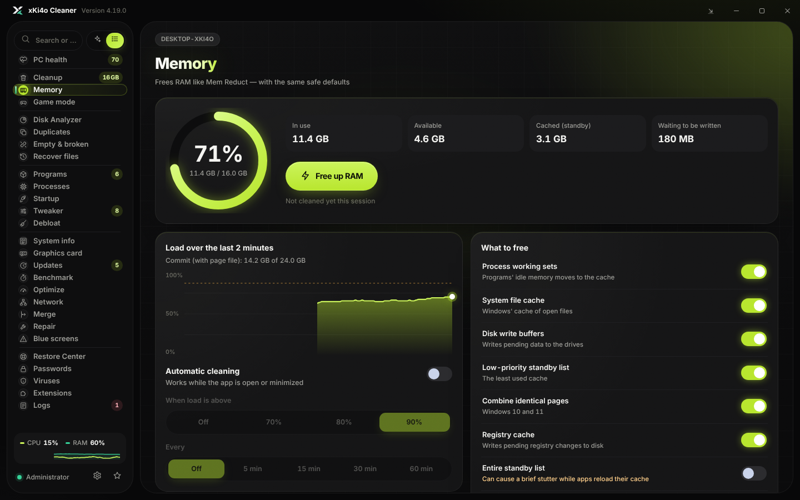

<div align="center">


# xKi4o Cleaner

**A fast, careful Windows cleaner with a RAM optimizer and a tweaker.**
Made by **xKi4o**.


</div>

xKi4o Cleaner scans your PC first and shows exactly how much space every
category takes, then cleans only what you pick — or everything at once with
one button. The Tweaker turns more than 50 Windows tweaks on and off, and every
one of them can be undone. It ships as one portable `.exe` with no installer,
in English and Bulgarian.

## Features

**Cleanup**

- Scans before it deletes: every category shows its size, grouped into
  System, Browsers, Apps, Graphics, Windows Update and Privacy.
- Search the categories, sort them by group or largest first, and hide the
  empty ones. A compact bar with the clean buttons stays on top while you scroll.
- **Clean everything** — one button for every category, with optional extras
  (Recycle Bin, shader cache, DISM, Windows.old, recent files, clipboard, RAM,
  SSD TRIM) that you confirm before it starts.
- **Close open apps** — a browser or app that is running keeps its cache
  locked; one button closes them (normally first, then for good) so they can
  be cleaned.
- System: temporary files, Windows internet cache, Store app temp folders,
  Microsoft Store cache, crash dumps and error reports (including GPU
  WATCHDOG dumps), thumbnail cache, Recycle Bin, DNS cache.
- Browsers (cache only): Chrome, Edge, Brave, Vivaldi, Opera / Opera GX, Firefox.
- Apps: Discord, VS Code, Slack, Microsoft Teams, Notion, Telegram Desktop,
  Steam, Epic Games, Ubisoft Connect, Battle.net, EA app, GOG Galaxy, Riot
  Client, OBS Studio, and pip / npm / Yarn / Go / NuGet download caches.
- Graphics: old NVIDIA driver packages, NVIDIA and AMD installer leftovers,
  NVIDIA App cache and logs, and NVIDIA / AMD / Intel / DirectX / Steam shader caches.
- Windows Update: downloaded updates, Delivery Optimization cache, Windows
  logs, Windows Disk Cleanup leftovers, component store cleanup (DISM),
  Windows.old.

**Tweaker** — 52 tweaks in eight groups: performance, gaming, privacy,
taskbar and look, Explorer and keyboard, system, network and built-in apps.
It has a counterpart for every tweak of [Sparkle](https://github.com/Parcoil/Sparkle) plus
popular ones from [WinUtil](https://github.com/ChrisTitusTech/winutil):
services on demand, Ultimate Performance plan, HAGS, Game Mode, Game Bar,
mouse acceleration, NVIDIA driver settings, telemetry, Copilot, Recall, Bing
search, classic right-click menu, taskbar layout, dark mode, file extensions,
TCP settings, removing built-in apps, Edge or OneDrive, and more.

- Every switch shows the real setting read from Windows, not a saved guess.
- Turning a tweak off restores exactly what was there before (the old values
  are saved in `%LOCALAPPDATA%\xKi4oCleaner\tweaks-backup.json`).
- A restore point is made before the first system change.
- Risky tweaks ask first and say why; app removal lets you pick the apps.
- Nothing changes until you switch a tweak on.

**Memory** — works like Mem Reduct, with the same Windows calls and the same
safe defaults: live load gauge and 2-minute chart, one-click RAM freeing, and
automatic cleaning above a load threshold or on an interval.

**Optimize** — TRIM for SSDs (HDDs are left to Windows' own schedule).

**Repair** — DISM + SFC, SFC only, or a read-only disk check, with live output.

**Settings** — English / Bulgarian, six accent colours, animations on/off,
restore point options.

**Keyboard** — `F5` scan again, `Ctrl+F` search, `Ctrl+1…7` switch section,
`Esc` close a dialog or clear the search.

<p>


</p>

## Safety

Everything it deletes is cache or temporary data that Windows and the apps
rebuild by themselves. The rules were cross-checked against BleachBit and the
Winapp2 database, and only the conservative part was kept.

- **Never touched by cleaning:** Downloads, Documents, Desktop, browser
  history, cookies, passwords and logins, site data, downloaded Spotify songs,
  power plan, hibernation, startup apps, event logs, Prefetch, service
  settings, existing restore points, and the graphics driver currently in use.
  (Power plan, hibernation and services change only if you switch on the
  matching tweak yourself.)
- **Restore point first** before drivers, updates, DISM or Windows.old are
  cleaned (can be turned off in Settings).
- **Links are never followed.** Junctions and symlinks are removed as links;
  whatever they point to is left alone.
- **Protected roots.** A cleaning target must be at least two folders deep and
  can never be a folder like `C:\Windows`, `System32`, your user profile,
  AppData or Program Files.
- **TEMP files must be older than 24 hours**, so a running installer is left
  alone (the same default CCleaner uses).
- **Open apps are skipped** — their cache is cleaned only while they are closed.
- **Old NVIDIA drivers** are removed with Windows' own `pnputil`, never with
  `/force`, and never the one a GPU is using.
- **Windows Update cleanup waits** while Windows is installing updates.

## Download

Get `xKi4oCleaner.exe` from the [Releases](../../releases) page and run it.

- Windows 10 or 11, 64-bit.
- Microsoft Edge WebView2 Runtime — built into Windows 11 and present on
  updated Windows 10. If it is missing, the app offers the download link.
- The app asks for administrator rights when it starts (UAC).
- The exe is not code-signed, so Windows SmartScreen may show
  *"Windows protected your PC"*. Click **More info → Run anyway**.

## Build from source

You need [Go 1.24 or newer](https://go.dev/dl/).

```powershell
git clone https://github.com/<your-name>/xKi4o-Cleaner.git
cd xKi4o-Cleaner
.\build.ps1
```

or directly:

```powershell
go build -trimpath -ldflags "-s -w -H windowsgui" -o xKi4oCleaner.exe .
```

From Linux or macOS:

```sh
GOOS=windows GOARCH=amd64 go build -trimpath -ldflags "-s -w -H windowsgui" -o xKi4oCleaner.exe .
```

Run the tests (the file engine tests run on any OS):

```sh
go test ./...
```

### Changing the interface

The interface is `ui/app.html`. After editing it, regenerate the embedded
page (it inlines the font and the license texts):

```sh
python ui/build_ui.py
```

### Changing the icon or version info

`res/app.rc` holds the icon, the administrator manifest and the version info
(author, copyright). Rebuild the resource file with `windres` from MinGW-w64:

```sh
cd res
windres --preprocessor=cpp -i app.rc -O coff -o ../rsrc_windows_amd64.syso
```

## How it works

The app is written in Go. The window is a native Win32 window hosting
Microsoft Edge WebView2, so the interface is a single HTML page
(`ui/index.html`, embedded into the exe) that calls Go functions directly.
There is no web server and no network access.

| Path | What it is |
| --- | --- |
| `main_windows.go` | Window, bindings to the page, cleaning flow |
| `catalog_windows.go` | Every cleaning category and where its files live |
| `fsops.go` | File engine: safe targets, scanning, deleting without following links |
| `memory_windows.go` | RAM cleaner and automatic cleaning |
| `tasks_windows.go` | Windows Update, DISM, restore points, drives, repair tools |
| `tweaks_windows.go` | Tweaker engine: state detection, backup and undo |
| `tweaklist_windows.go` | Every tweak and what it changes |
| `nvapi_windows.go` | NVIDIA driver settings for the NVIDIA tweak |
| `apps_windows.go` | Closing open apps before cleaning |
| `ui/app.html` | The interface (English and Bulgarian texts included) |
| `third_party/go-webview2` | Patched copy of go-webview2 — see `PATCHES.md` |

## Credits

**Made by xKi4o** — idea, design and development.

- [go-webview2](https://github.com/jchv/go-webview2) by John Chadwick — MIT
- [go-winloader](https://github.com/jchv/go-winloader) by John Chadwick — ISC
- WebView2Loader.dll from the [Microsoft Edge WebView2 SDK](https://www.nuget.org/packages/Microsoft.Web.WebView2) by Microsoft Corporation (embedded in the exe) — BSD-3-Clause, see `third_party/go-webview2/webviewloader/sdk/LICENSE.txt`
- [Go](https://go.dev) and [golang.org/x/sys](https://pkg.go.dev/golang.org/x/sys) by The Go Authors — BSD-3-Clause
- [Montserrat](https://github.com/JulietaUla/Montserrat) by The Montserrat Project Authors — SIL Open Font License 1.1
- [WinUtil](https://github.com/ChrisTitusTech/winutil) by Chris Titus Tech — MIT (registry values of several tweaks), see `third_party/licenses/winutil-LICENSE`
- [NVIDIA NVAPI SDK](https://github.com/NVIDIA/nvapi) by NVIDIA Corporation — MIT (driver settings interface), see `third_party/licenses/nvapi-LICENSE`

Thanks to [BleachBit](https://www.bleachbit.org),
[Winapp2](https://github.com/MoscaDotTo/Winapp2) and
[Mem Reduct](https://github.com/henrypp/memreduct) — their public rules and
behaviour were used as a reference. No code was copied from them.

The Tweaker follows the tweak list of [Sparkle](https://github.com/Parcoil/Sparkle)
(GPL-3.0). None of its code is used: every tweak was written anew in Go from
the documented Windows settings, with state detection and undo added.

## License

[MIT](LICENSE) © 2026 xKi4o. Third-party components keep their own licenses
(`third_party/`, `ui/fonts/OFL.txt`).

Cleaning tools delete files. xKi4o Cleaner is provided as is, without
warranty — see the license.

---

## На български

**xKi4o Cleaner** е бърз и внимателен почистващ инструмент за Windows с
вграден оптимизатор на RAM. Направен е от **xKi4o**.

Първо сканира и показва колко място заема всяка категория, а после чисти само
избраното или всичко наведнъж с бутона **„Почисти всичко“**. Чисти кеша на
браузъри и програми, временни файлове, стари NVIDIA драйвери, ъпдейти и
логове. Разделът **„Памет“** освобождава RAM като Mem Reduct, включително
автоматично. Има и TRIM за SSD, поправка на Windows (DISM, SFC, CHKDSK),
търсене и сортиране на категориите, шест цвята на акцента и превключване
между английски и български в **„Настройки“**.

Разделът **Tweaker** включва и изключва над 50 настройки на Windows —
всички туийкове на Sparkle и популярни от WinUtil (услуги, план Ultimate
Performance, HAGS, Game Bar, телеметрия, Copilot, класическо меню, тъмен режим,
премахване на вградени приложения и др.). Всеки превключвател показва
истинската настройка в Windows, а при изключване се връща точно това, което е
било преди. Ако програма е отворена и кешът ѝ е заключен, бутонът
**„Затвори ги“** я затваря.

Почистването не пипа лични файлове, пароли, история, настройките на
захранването и програмите при стартиране — те се променят само ако сам
включиш съответния туийк. Преди системни промени се прави точка за
възстановяване.

Свали `xKi4oCleaner.exe` от страницата [Releases](../../releases).
