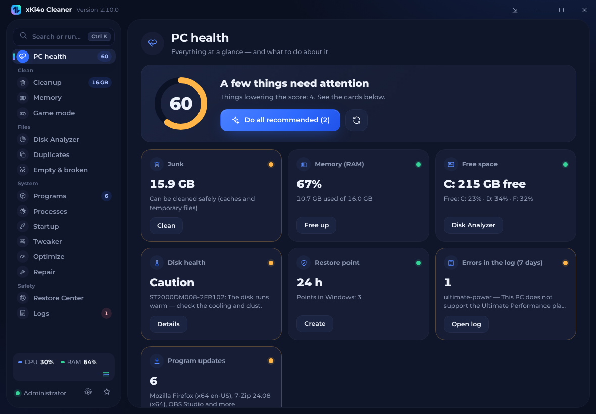
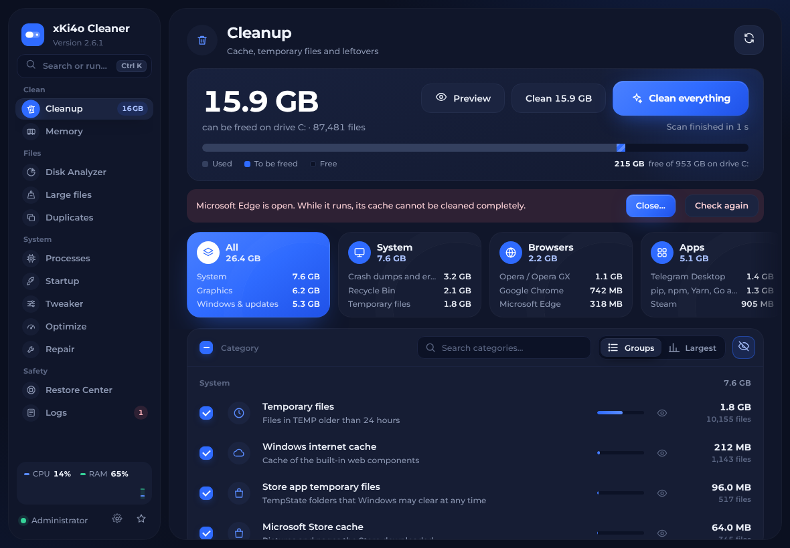
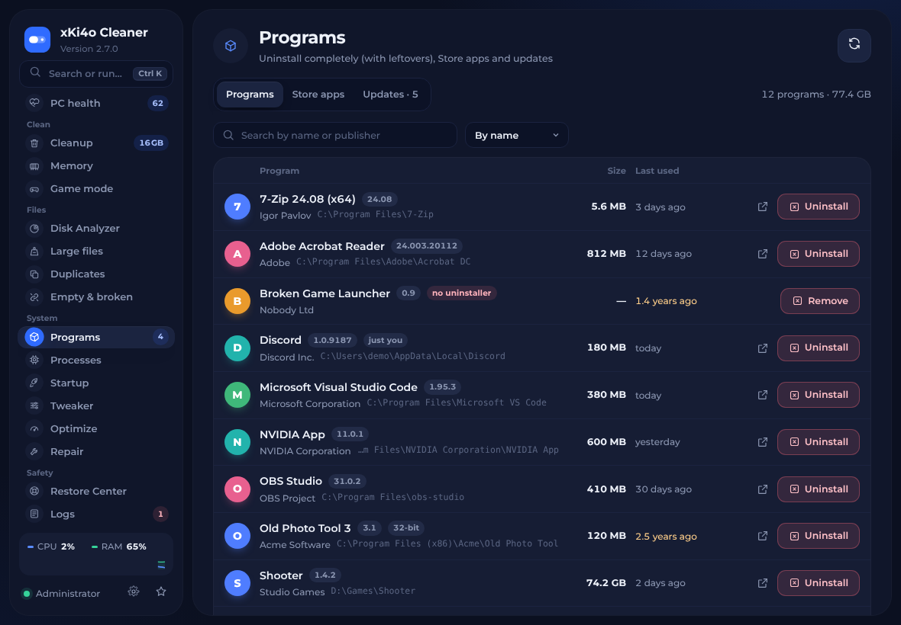
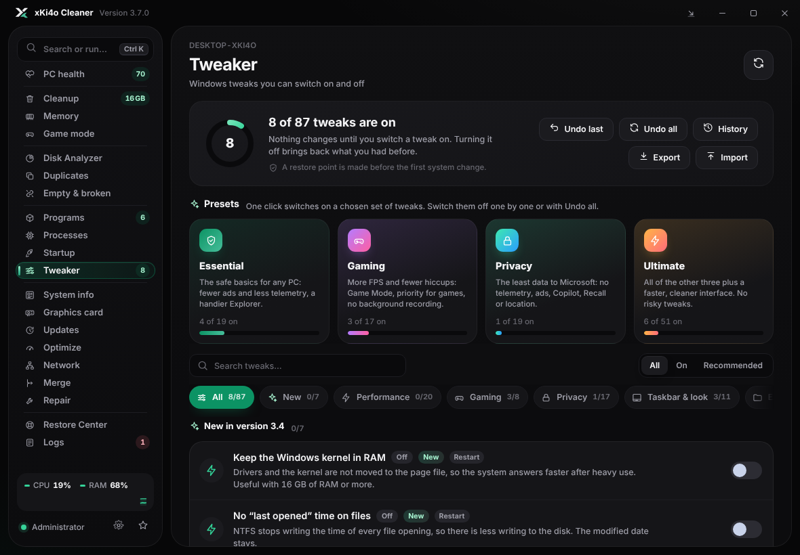
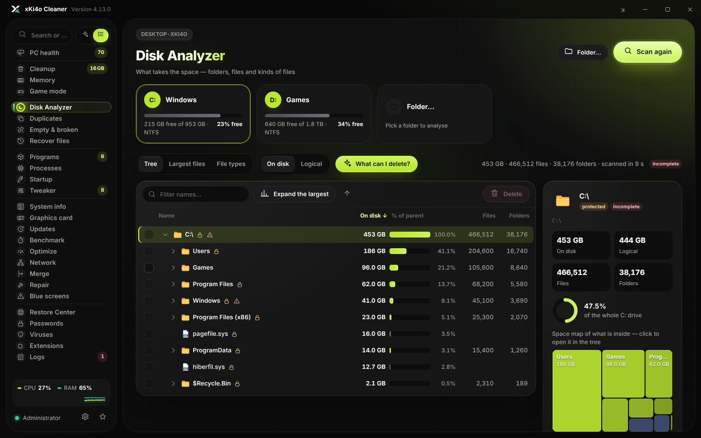
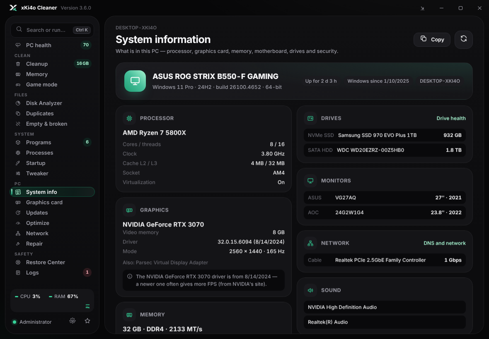
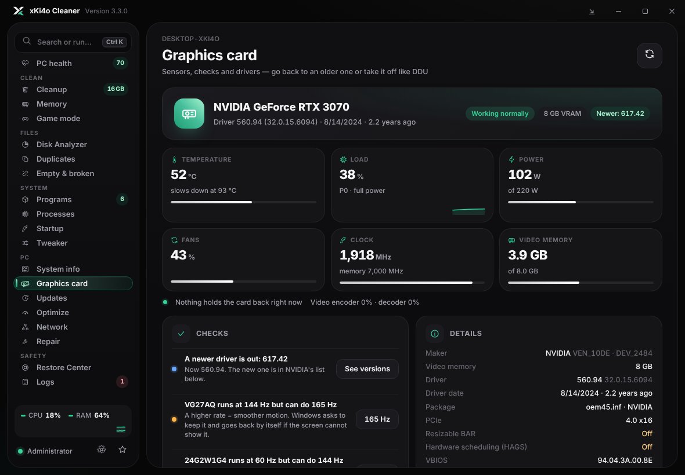
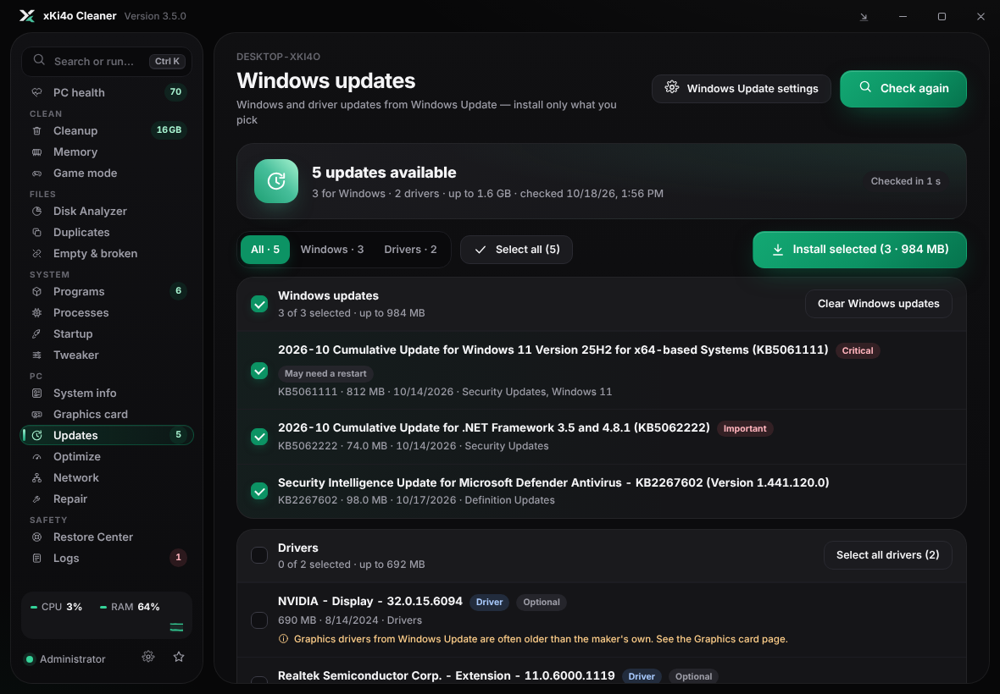
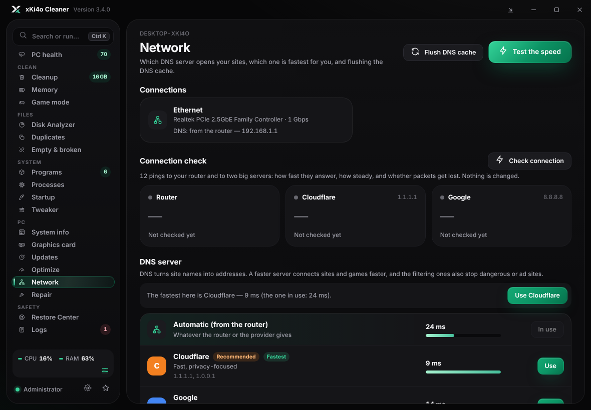

<div align="center">


# xKi4o Cleaner

**The all-in-one Windows 10 / 11 cleaner, optimizer and tweaker — one portable exe, no telemetry, in English and Bulgarian.**

Clean junk safely, apply 90 reversible tweaks, boost games, update Windows and drivers, check your disks, GPU and network — and undo anything in one click.

[](../../releases/latest)
[](../../releases)

[](LICENSE)

### [⬇ Download xKi4oCleaner.exe](../../releases/latest/download/xKi4oCleaner.exe)



</div>

## Quick start

1. Download **xKi4oCleaner.exe** from the [latest release](../../releases/latest) — no installer.
2. Run it and allow the administrator prompt.
3. If Windows SmartScreen says *"Windows protected your PC"* (the exe is not code-signed), click **More info → Run anyway**.

Needs Windows 10 or 11 (64-bit) and the WebView2 Runtime, which Windows 11 already has. New versions are offered by the app itself.

## Features

| | |
| --- | --- |
| **PC health** | A live dashboard — processor, graphics card (temperature and video memory on NVIDIA), memory, system drive and network — with one score, what lowers it, and one button for what is recommended |
| **Cleanup** | Caches and temporary files of Windows, browsers, games and apps — the size of each before you clean |
| **Programs** | Uninstall with a scan for leftovers (like Revo), remove Store apps, update programs with winget |
| **Tweaker** | About 90 Windows tweaks and one-click presets (Essential, Gaming, Privacy, Ultimate); switching one off brings back exactly what you had |
| **Memory and game mode** | Free RAM; close the programs you choose while you play and start them again after |
| **Disks** | Disk Analyzer, disk health (S.M.A.R.T., what the errors mean and what helps), TRIM and defragmentation, duplicates, empty folders, broken shortcuts |
| **Graphics card** | Live sensors (temperature, power, fans, clocks on NVIDIA), checks (refresh rate, PCIe lanes, Resizable BAR, HAGS), go back to an older driver or download one from NVIDIA, and remove the driver like DDU — with a copy to put it back |
| **Updates** | Search for Windows and driver updates and install the ones you tick, with a restore point and a log — through Windows Update itself |
| **System info** | Processor, graphics card, memory sticks, motherboard, drives, monitors, security and battery — with tips (XMP, old drivers) and a report to copy |
| **Network** | Switch DNS (Cloudflare recommended, Google, AdGuard…) after a speed test that shows the fastest for you; a connection check (ping, jitter, lost packets); flush the DNS cache |
| **System** | Processes, startup apps, Windows repair (DISM, SFC, disk check) and quick fixes (Explorer, icons, Store, Winsock) |
| **Automatic cleaning** | Daily, weekly or monthly, with no window; open apps and sensitive categories are left out |
| **Restore Center** | Puts back what the app changed; every operation has a step-by-step log |

<p align="center">








</p>

## Is it safe?

- It deletes only caches and temporary data that Windows and the apps rebuild. Documents, downloads, browser history, passwords, game saves and app settings are never touched.
- Files you pick yourself (Disk Analyzer, duplicates) go to the Recycle Bin and can be restored.
- Windows Update is never turned off; updates install only when you pick them. Defender, hibernation, power plans and startup apps change only when you switch them yourself.
- A restore point is made before system changes, and every tweak can be undone. DNS changes go back with one click too.
- No telemetry. The app itself only asks GitHub whether there is a new version (this can be turned off); program updates go through winget.

## FAQ

**Why does it need administrator rights?** Most caches, the tweaks and the uninstaller need them. Programs the app starts again (after game mode or an update) run without them.

**Can I keep it running in the background?** Yes — the button next to minimize sends it to the tray, next to the clock. Click the icon to open it again. When a long job ends there, Windows shows a notification.

**Does automatic cleaning need the app open?** No. Windows' Task Scheduler starts it at the chosen time. Turn it off in Settings before you delete the app.

**Can I have the old blue look back?** Yes — Settings → Theme → Ocean. The accent colour is chosen right below it.

**Windows Defender says "Trojan:Win32/Bearfoos" — is it a virus?** No — it is a false positive. The `!ml` at the end means Defender's machine-learning guess, not a known virus: an unsigned exe that cleans files, reads processes and changes settings looks suspicious to it. What you can do:
1. Check that your file is the real one: its SHA-256 must match the one under the [release](../../releases/latest) (PowerShell: `Get-FileHash .\xKi4oCleaner.exe`). Download it only from this page.
2. Report the false positive to Microsoft — [submit the file here](https://www.microsoft.com/en-us/wdsi/filesubmission) ("Software developer" or "Home customer", "Incorrectly detected"). Once Microsoft clears it, the warning goes away for everyone.
3. If you trust the file, you can restore it yourself in Windows Security → Protection history. The app never turns Defender off and never adds exceptions by itself.

**How do I undo something?** Switch the tweak off, or open the Restore Center: tweaks, startup changes, deleted files and registry backups are all there.

## Build from source

You need [Go 1.24 or newer](https://go.dev/dl/).

```sh
git clone https://github.com/Ki4o112/xKi4o-Cleaner.git
cd xKi4o-Cleaner
GOOS=windows GOARCH=amd64 go build -trimpath -ldflags "-s -w -H windowsgui" -o xKi4oCleaner.exe ./src
```

<details>
<summary>Tests, the interface, releases</summary>

- `go test ./...` runs everywhere; the Windows tests run on Windows or under Wine (`GOOS=windows go test -c -o wtests.exe ./src`). On a real PC they only read the system.
- The app is in `src/`. The interface is `src/ui/app.html`; after changing it run `python src/ui/build_ui.py`. `src/tests/ui_flows.py` checks it in Chromium with its demo backend.
- The icon and version info are in `src/res/` (`windres -i app.rc -O coff -o ../rsrc_windows_amd64.syso`).
- A release: set the version in `src/version.go` and `src/res/app.rc`, add it to `CHANGELOG.md` (English and Bulgarian), push, then run **Actions → Build and release**.

</details>

## Credits

Made by **xKi4o**. Built with [go-webview2](https://github.com/jchv/go-webview2), [Go](https://go.dev) and the [Inter](https://github.com/rsms/inter) font. The cleaning rules were checked against [BleachBit](https://www.bleachbit.org) and [Winapp2](https://github.com/MoscaDotTo/Winapp2), RAM cleaning follows [Mem Reduct](https://github.com/henrypp/memreduct), and the Tweaker follows the lists of [Sparkle](https://github.com/Parcoil/Sparkle), [WinUtil](https://github.com/ChrisTitusTech/winutil) and the [ReviOS playbook](https://github.com/meetrevision/playbook) — everything was written anew. Licenses of the components are in `src/third_party/` and on the app's Credits page.

## License

[MIT](LICENSE) © 2026 xKi4o. Provided as is, without warranty.

---

<details>
<summary><b>На български</b></summary>

**xKi4o Cleaner** е внимателен почистващ инструмент за Windows — един файл, без инсталация, на български и английски.

**Как се пуска:** свали **xKi4oCleaner.exe** от [последната версия](../../releases/latest), пусни го и разреши администраторските права. Ако SmartScreen каже *„Windows защити компютъра ви“*, натисни **Още информация → Изпълни въпреки това**.

**Какво може:** здраве на компютъра с една оценка, почистване на кеш и временни файлове (и автоматично по график), деинсталиране с остатъци, обновяване на програми, около 80 туийка с връщане назад и пресети (Игри, Поверителност…), освобождаване на RAM, режим „Игри“, анализ и здраве на дисковете, дубликати, празни папки, информация за системата, смяна на DNS с тест на скоростта, контекстното меню, процеси, стартиращи програми, поправка на Windows и център за възстановяване.

**Безопасно ли е:** трие само кеш и временни данни. Лични файлове, история, пароли и запазени игри не се пипат. Избраните от теб файлове отиват в кошчето. Windows Update, Defender, хибернацията, плановете за захранване и стартиращите програми се променят само ако ти ги превключиш.

**Windows Defender казва „Trojan:Win32/Bearfoos“:** това е фалшива тревога. `!ml` значи предположение на машинното обучение на Defender, не познат вирус — неподписан exe, който трие файлове и сменя настройки, му изглежда подозрителен. Провери, че SHA-256 на файла съвпада с този под [версията](../../releases/latest), и докладвай грешката на Microsoft [тук](https://www.microsoft.com/en-us/wdsi/filesubmission). Ако вярваш на файла, можеш сам да го върнеш от Windows Security → История на защитата. Програмата никога не изключва Defender и не добавя изключения сама.

**Във фона:** бутонът до „минимизирай“ скрива програмата в трея, до часовника — тя продължава да работи.

</details>
