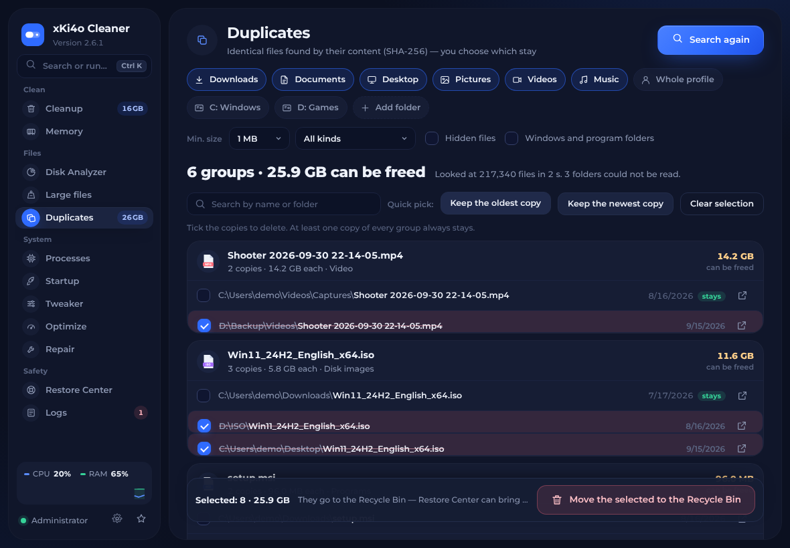
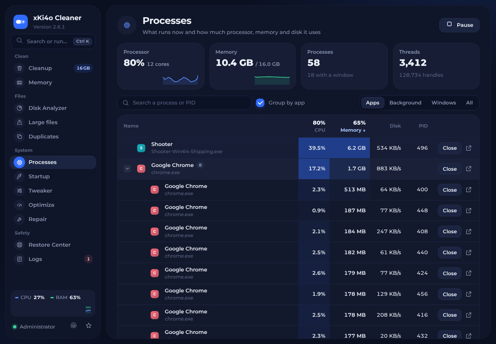
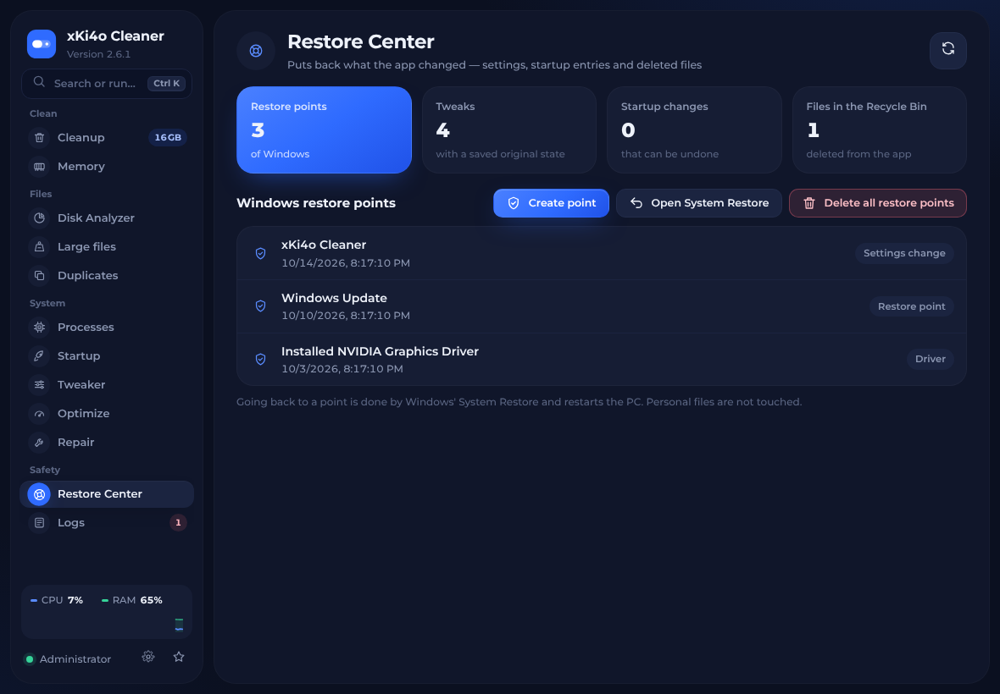
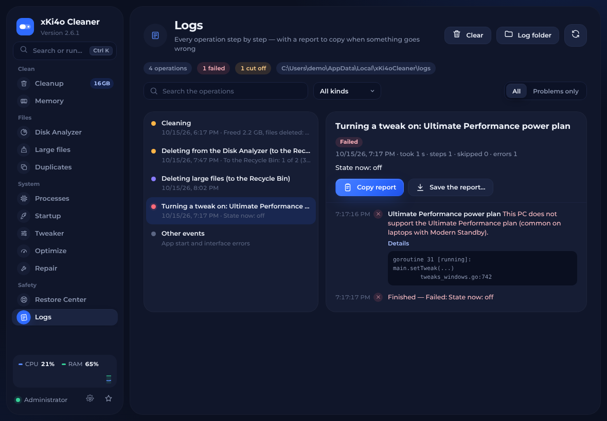
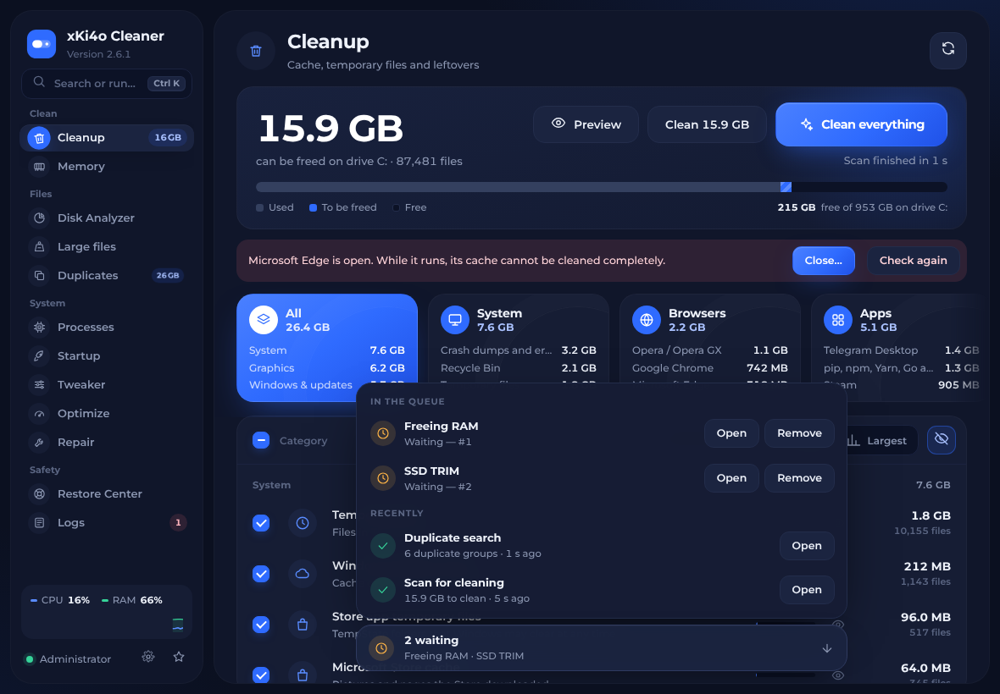
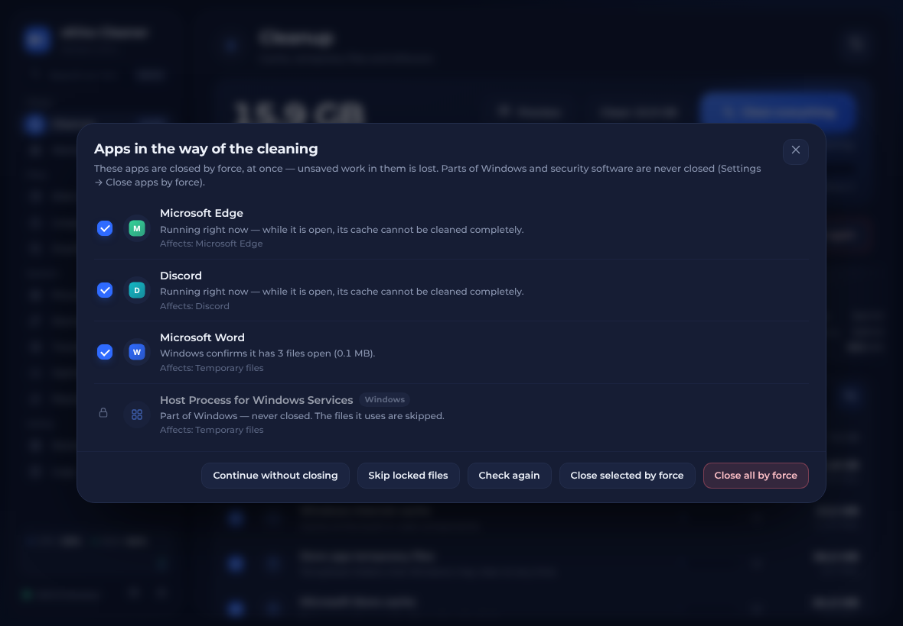
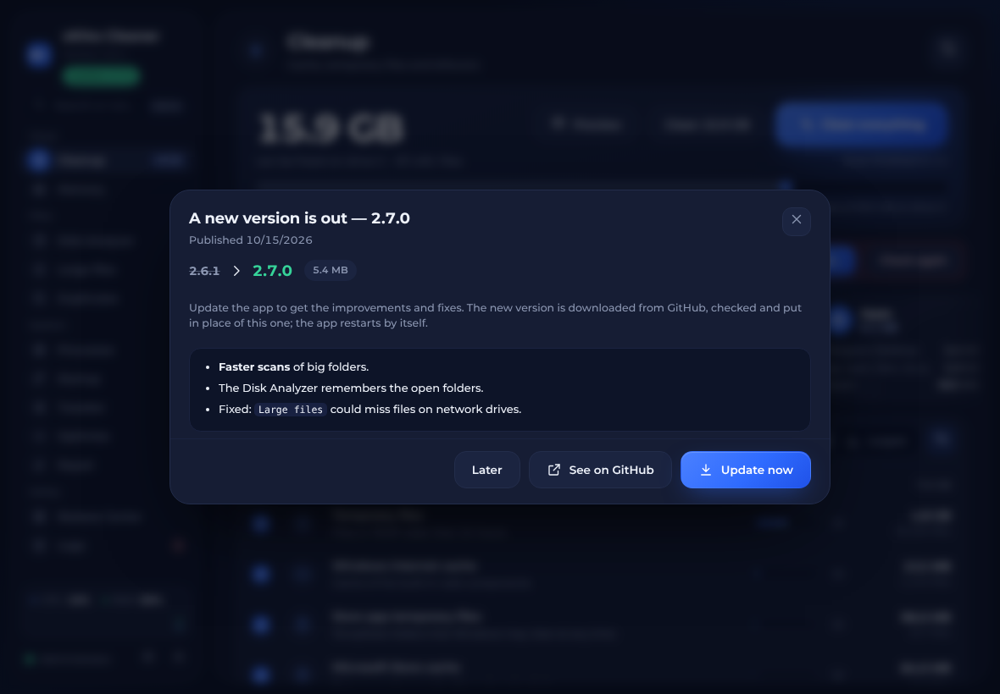

<div align="center">


# xKi4o Cleaner

**A fast, careful Windows cleaner and toolbox — cleanup, duplicates, large files, processes, tweaks, and a way back for every change.**
Made by **xKi4o**.


</div>

xKi4o Cleaner scans your PC first and shows exactly how much space every
category takes, then cleans only what you pick — or everything at once with
one button. The Tweaker turns about 50 Windows tweaks on and off and can put
back the exact earlier state of every one; the Startup Manager, the Disk
Analyzer, the Large Files and Duplicate finders and the Process Manager show
what starts with Windows, what fills the disk and what runs right now. The
Restore Center puts back anything the app changed, and every operation is
logged step by step with a report you can copy in one click. It ships as one
portable `.exe` with no installer, in English and Bulgarian.

## Features

**Cleanup**

- Scans before it deletes: every category shows its size and number of files,
  grouped into System, Browsers, Apps, Graphics, Windows & updates and Privacy.
- **Preview (dry run)** — shows what would be deleted, category by category,
  including files that are in use right now. Nothing is deleted.
- **See the files** of any category, largest first, and untick single files or
  folders to keep them.
- After cleaning, the **report** lists per category what was deleted, what was
  skipped because it is in use, what had no access and what failed (with the
  paths), plus the change of free space Windows measured. The number shown is
  what was really deleted, not the estimate.
- **Apps in the way** — before cleaning, the app checks which programs would
  stop it: the app of a chosen category that is running, or a program that
  Windows' Restart Manager confirms has the files open. Each one is listed with
  the reason, the affected categories and the program's own icon, and you
  choose: *Close selected*, *Close all*, *Check again*, *Skip locked files* or
  *Continue without closing*. By default apps are **closed by force**, at once —
  that always works, and the dialog says that unsaved work in them is lost.
  With *Settings → Close apps by force* turned off they are closed the normal
  way instead (each app can save or refuse) and a forced close needs its own
  confirmation. Parts of Windows (anything running from the Windows folder or
  made as part of Windows, e.g. CrossDeviceResume or ShellHost), services,
  security software and other users' programs are never offered for closing.
- A file is deleted only if no program has it open; files in use are skipped
  and reported — never forced, never retried in a loop.
- System: temporary files, Windows internet cache, Store app temp folders,
  Microsoft Store cache, crash dumps and error reports, thumbnail cache, DNS
  cache, and — only when you tick them — Recycle Bin, recent-files list and
  clipboard.
- Browsers (cache only): Chrome, Edge, Brave, Vivaldi, Opera / Opera GX, Firefox.
- Apps: Discord, VS Code, Slack, Microsoft Teams, Notion, Telegram Desktop,
  Steam, Epic Games, Ubisoft Connect, Battle.net, EA app, GOG Galaxy, Riot
  Client, OBS Studio, and pip / npm / Yarn / Go / NuGet download caches.
- Graphics: NVIDIA, AMD and Intel installer leftovers and logs, NVIDIA App
  cache, NVIDIA / AMD / Intel / DirectX / Steam shader caches, and — as a
  separate choice — old NVIDIA driver packages no graphics card uses.
- Windows & updates: downloaded updates and Delivery Optimization cache,
  Windows logs, Windows Disk Cleanup leftovers, component store cleanup (DISM),
  and — as separate choices — Windows.old and **unneeded installer packages**
  (`C:\Windows\Installer` files that Windows Installer itself confirms belong
  to nothing installed).

**Tweaker** — about 50 tweaks in eight groups (performance, gaming, privacy,
taskbar and look, Explorer and keyboard, system, network, built-in apps),
following [Sparkle](https://github.com/Parcoil/Sparkle) plus popular ones from
[WinUtil](https://github.com/ChrisTitusTech/winutil).

- Before every change a full snapshot is taken: registry value types, values,
  missing values and keys, service start types, and settings outside the
  registry (power plan, boot option, NVIDIA driver settings, Windows Terminal,
  Defender options). Turning a tweak off restores exactly that — values that
  did not exist are deleted again, created keys removed — also after a restart.
- After every change the real state is read back. A change Windows did not take
  is undone and shown as an error, never as success.
- States: **On**, **Off**, **Changed elsewhere**, **Needs a restart**, **Error**.
- **History** of every change with date, time and result; **Undo last**;
  **Undo all** (shows the list first); **export / import** of profiles.
- No guessed values: a tweak that was not turned on from the app is turned off
  with the Windows defaults only after you agree.
- Administrator rights and the Windows version are checked per tweak; no two
  tweaks change the same setting (checked by a test).

**Startup Manager** — what starts with Windows from the Run keys, the Startup
folders and Task Scheduler (log-on and boot tasks): name, program and path,
source, publisher (from the digital signature), status and details. Turn
entries off and on the same reversible way Windows does (StartupApproved, or
the task's own setting) — nothing is deleted. Missing programs and entries
worth a closer look are marked (without calling anything a virus), security
and driver components ask first, and every change is logged with a backup that
can be restored.

**Disk Analyzer** — a tree like TreeSize. The drives are listed with how full
they are and how much is free in %. A drive or folder is scanned in the
background (with progress and Stop), then shown as an expandable tree: size
(on disk or logical), **% of the parent folder** with a bar, files, folders and
last change, sortable by any column, with real file and folder icons. Folders
open in place (also with the arrow keys), *Expand the largest* follows where
the space goes, and a filter finds names in the open folders. The side panel
shows the selected item — sizes, share of the drive and a space map of what is
inside. Two more views list the largest files (filters for size, kind,
extension, folder and name) and the space by kind of file and by extension.
Open anything in Explorer, rescan one folder without scanning everything
again, and move chosen items to the Recycle Bin after a confirmation that shows
the exact paths and sizes. Links and junctions are never followed, folders
without access are marked and skipped, and protected Windows items cannot be
deleted.

**Large files** — finds the biggest files on the chosen drives and folders
fast (several folders are read at once): minimum size, kind of file and age
filters, a breakdown by kind, search and sorting, open in Explorer, and move
the chosen files to the Recycle Bin after a confirmation that lists them.
Windows, program folders and AppData are left out unless you ask; files there
are listed but never deleted from the app.

**Duplicates** — finds identical files by their content: same size, then the
same first and last 64 KB, then the same **SHA-256** of the whole file. Hard
links are recognised (two names of one file are not a copy), cloud files that
are not on the PC are skipped (reading them would download them), and links
are never followed. Nothing is selected for you; *Keep the oldest* / *Keep the
newest* select the other copies in one click, and the last copy of a group can
never be selected. Before anything moves to the Recycle Bin, each file is
checked again, and the copy that stays is read again to make sure it still has
the same content.

**Processes** — like Task Manager's list: CPU, memory (private working set),
disk use, PID, threads and handles, grouped by app, with live CPU and memory
graphs. *Close* asks the app to close the normal way; ending one by force needs
a second confirmation that warns about unsaved work. Windows, services,
security software, other users' processes and the app itself can never be
ended from here.

**Restore Center** — everything the app can put back, in one place: Windows'
restore points (list, create, open System Restore, and a red **Delete all
restore points** button — after a confirmation, optionally keeping the newest
one — so they do not pile up), every tweak whose original
state was saved (restore one or all, undo the last change), startup changes
(only the latest change of each entry, so nothing newer is undone), and the
files the app moved to the Recycle Bin — put back to where they were, never
over a file that is there now.

**Logs & error reports** — every operation (cleaning, tweaks, startup changes,
deletions, closing processes, restores, repairs) is written to
`%LOCALAPPDATA%\xKi4oCleaner\logs` step by step: what was done, what was
skipped and why, every error with its details. An operation that never
finished (the app was closed or crashed) is shown as cut off. When something
fails, a toast offers **Copy report**; the report has the app and Windows
version, the steps and the latest problems elsewhere, with your user folder
replaced by `%USERPROFILE%`. Errors of the interface itself are logged too.

**Background jobs** — long jobs (the cleanup scan and cleaning, freeing RAM,
TRIM, repairs, restore points, the Disk Analyzer, Large files and Duplicates)
run one at a time while you keep using the other sections. Starting another
one puts it in a queue (a notice says after which job it starts), and a small
bar at the bottom of every other section shows what is running, its progress
and what waits; from there a job can be opened, stopped, or taken out of the
queue.

**Updates** — when the app starts it asks GitHub for the latest release (one
request; can be turned off in Settings). If there is a newer version, it
shows what is new — in English or Bulgarian, as the app is set — and **Update
now** downloads it, checks it (the size and SHA-256 that GitHub gives, and
that it is a Windows program), puts it in place of the running exe and
restarts. After an update the app shows once what changed; *Settings →
What's new* shows it any time. Every version's changes are in
[CHANGELOG.md](CHANGELOG.md).

**Real icons** — the cleanup categories of apps, the Processes and Startup
lists, the apps in the way of a cleaning, the Disk Analyzer, Large files,
Duplicates and the Restore Center show the real icons of the programs and
files, as Explorer draws them.

**Command palette** — `Ctrl+K` finds any section, action, tweak, cleanup
category or open app by typing a few letters.

**Memory** — works like Mem Reduct, with the same Windows calls and the same
safe defaults: live load gauge and 2-minute chart, one-click RAM freeing, and
automatic cleaning above a load threshold or on an interval.

**Optimize** — TRIM for SSDs (HDDs are left to Windows' own schedule).

**Repair** — DISM + SFC, SFC only, or a read-only disk check, with live output.

**Settings** — English / Bulgarian, six accent colours, animations on/off,
the live CPU/RAM graph in the sidebar on/off, restore point options, closing
apps by force before cleaning. The places and filters of the finders are
remembered.

**Keyboard** — `Ctrl+K` search and commands, `F5` scan again, `Ctrl+F` search
on the page, `Ctrl+1…9` switch section, `Esc` close a dialog or clear the
search.

<p>









</p>

## Safety

Everything the cleaner deletes is cache or temporary data that Windows and the
apps rebuild by themselves. The rules were cross-checked against BleachBit, the
Winapp2 database and Windows Disk Cleanup, and only the conservative part was
kept (no code copied).

- **Never touched by cleaning:** Downloads, Documents, Desktop, browser
  history, cookies, passwords and logins, site data, game saves, mods, app
  settings, OBS scenes, power plan, hibernation, startup apps, event logs,
  Prefetch, service settings, existing restore points, and the graphics driver
  in use.
- **Sensitive categories** (Recycle Bin, recent files, clipboard, Windows.old,
  old drivers, installer packages) are never selected for you.
- **Files in use stay.** A file is deleted only when no program has it open.
- **Restore point first** before drivers, updates, installer packages, DISM or
  Windows.old (can be turned off in Settings).
- **Windows Update files wait** while Windows is downloading or installing
  updates, waits for a restart, or has an unfinished servicing operation —
  the reason is shown.
- **Links are never followed.** Junctions and symlinks are removed as links;
  whatever they point to is left alone.
- **Protected roots.** A cleaning target must be at least two folders deep and
  can never be a folder like `C:\Windows`, `System32`, your user profile,
  AppData or Program Files.
- **TEMP files must be older than 24 hours**, so a running installer is left alone.
- **Old NVIDIA drivers** are removed with Windows' own `pnputil`, never with
  `/force`, and never one a graphics card uses. Disk Cleanup's own driver
  package removal is not used.
- **Files chosen by you go to the Recycle Bin** (Disk Analyzer, Large files,
  Duplicates) and can be restored from the Restore Center. Windows and
  program files, system files and other users' files are never deleted.
- **Nothing is ever turned off by itself**: Windows Update, Defender and other
  protection, hibernation, power plans and startup apps change only when you
  switch them yourself.
- **A crash cannot take the app down mid-work**: an unexpected error in a
  background task is logged and the app goes on.

## Download

Get `xKi4oCleaner.exe` from the [latest release](../../releases/latest) and
run it. Later versions are offered by the app itself.

- Windows 10 or 11, 64-bit.
- Microsoft Edge WebView2 Runtime — built into Windows 11 and present on
  updated Windows 10. If it is missing, the app offers the download link.
- The app asks for administrator rights when it starts (UAC).
- The exe is not code-signed, so Windows SmartScreen may show
  *"Windows protected your PC"*. Click **More info → Run anyway**.

## Build from source

You need [Go 1.24 or newer](https://go.dev/dl/).

```powershell
git clone https://github.com/Ki4o112/xKi4o-Cleaner.git
cd xKi4o-Cleaner
.\build.ps1
```

or directly:

```powershell
go build -trimpath -ldflags "-s -w -H windowsgui" -o xKi4oCleaner.exe .
```

From Linux or macOS:

```sh
GOOS=windows GOARCH=amd64 go build -trimpath -ldflags "-s -w -H windowsgui" -o xKi4oCleaner.exe .
```

Run the tests (the file engine, the finders, the log, the Recycle Bin
restore, disk scan and startup helpers run on any OS; the Windows tests —
registry snapshots, tweak undo and history, startup toggling, locked files,
the blocker check, the process list, hard links — need Windows or Wine):

```sh
go test ./...
GOOS=windows GOARCH=amd64 go test -c -o wtests.exe . && wine wtests.exe -test.v
```

On a real PC the Windows tests only read the system and work in their own
temporary folders: the tests that write to the registry or close other
programs skip themselves unless they run under Wine (or `XKI4O_WRITE_TESTS=1`
is set on purpose). No test changes hibernation, power plans, boot settings,
services or startup apps.

`tests/ui_flows.py` drives the interface (with its built-in demo backend) in
Chromium through Playwright and checks the main flows of every section.

### Releasing a new version

1. Set the new version in `version.go` (`appVersion`) and in `res/app.rc`
   (then rebuild the resource file, see below).
2. Add a `## X.Y.Z — date` section at the top of `CHANGELOG.md` with an
   `### English` and a `### Български` list (a test checks both are there).
3. Commit, then tag and push:

   ```sh
   git tag vX.Y.Z
   git push origin main vX.Y.Z
   ```

The workflow in `.github/workflows/release.yml` tests and builds the exe and
publishes the release `vX.Y.Z` with `xKi4oCleaner.exe` and that version's
notes. Every copy of the app then shows the update when it starts.

### Changing the interface

The interface is `ui/app.html`. After editing it, regenerate the embedded
page (it inlines the font and the license texts):

```sh
python ui/build_ui.py
```

### Changing the icon or version info

`res/app.rc` holds the icon, the administrator manifest and the version info
(author, copyright). Rebuild the resource file with `windres` from MinGW-w64:

```sh
cd res
windres --preprocessor=cpp -i app.rc -O coff -o ../rsrc_windows_amd64.syso
```

## How it works

The app is written in Go. The window is a native Win32 window hosting
Microsoft Edge WebView2, so the interface is a single HTML page
(`ui/index.html`, embedded into the exe) that calls Go functions directly.
There is no web server. The only network access is the update check (one
request to the GitHub API for the latest release of this repository, which can
be turned off) and, after you click *Update now*, the download of the new exe
from this repository's releases.

| Path | What it is |
| --- | --- |
| `main_windows.go` | Window, bindings to the page, cleaning flow |
| `catalog_windows.go` | Every cleaning category and where its files live |
| `fsops.go` | File engine: safe targets, scanning, deleting without following links |
| `memory_windows.go` | RAM cleaner and automatic cleaning |
| `tasks_windows.go` | Windows Update, DISM, restore points, drives, repair tools |
| `tweaks_windows.go` | Tweaker engine: state detection, backup and undo |
| `tweaklist_windows.go` | Every tweak and what it changes |
| `nvapi_windows.go` | NVIDIA driver settings for the NVIDIA tweak |
| `locks_windows.go` | Finding the apps in the way (Restart Manager) and closing them |
| `apps_windows.go` | The normal close message for apps |
| `installer_windows.go` | Unneeded Windows Installer packages |
| `tweakhist_windows.go` | Tweak history, undo, profiles |
| `startup_windows.go`, `startuputil.go` | Startup Manager |
| `diskscan.go`, `diskscan_windows.go` | Disk Analyzer |
| `finder.go`, `finderjob.go`, `finder_windows.go` | Large Files and Duplicate finders |
| `procs_windows.go` | Process Manager and the live CPU/RAM readout |
| `recyclebin.go`, `restore_windows.go`, `restorepoints.go` | Restore Center, putting files back from the Recycle Bin, deleting restore points |
| `icons_windows.go` | Real icons of programs, files and folders for the page |
| `update.go`, `update_windows.go`, `version.go`, `CHANGELOG.md` | Update check and install from GitHub releases, the version and its list of changes |
| `oplog.go`, `oplog_windows.go` | Operation log, error reports, clipboard |
| `ui/app.html` | The interface (English and Bulgarian texts included) |
| `third_party/go-webview2` | Patched copy of go-webview2 — see `PATCHES.md` |

## Credits

**Made by xKi4o** — idea, design and development.

- [go-webview2](https://github.com/jchv/go-webview2) by John Chadwick — MIT
- [go-winloader](https://github.com/jchv/go-winloader) by John Chadwick — ISC
- WebView2Loader.dll from the [Microsoft Edge WebView2 SDK](https://www.nuget.org/packages/Microsoft.Web.WebView2) by Microsoft Corporation (embedded in the exe) — BSD-3-Clause, see `third_party/go-webview2/webviewloader/sdk/LICENSE.txt`
- [Go](https://go.dev) and [golang.org/x/sys](https://pkg.go.dev/golang.org/x/sys) by The Go Authors — BSD-3-Clause
- [Montserrat](https://github.com/JulietaUla/Montserrat) by The Montserrat Project Authors — SIL Open Font License 1.1
- [WinUtil](https://github.com/ChrisTitusTech/winutil) by Chris Titus Tech — MIT (registry values of several tweaks), see `third_party/licenses/winutil-LICENSE`
- [NVIDIA NVAPI SDK](https://github.com/NVIDIA/nvapi) by NVIDIA Corporation — MIT (driver settings interface), see `third_party/licenses/nvapi-LICENSE`

Thanks to [BleachBit](https://www.bleachbit.org),
[Winapp2](https://github.com/MoscaDotTo/Winapp2) and
[Mem Reduct](https://github.com/henrypp/memreduct) — their public rules and
behaviour were used as a reference. No code was copied from them.

The Tweaker follows the tweak list of [Sparkle](https://github.com/Parcoil/Sparkle)
(GPL-3.0). None of its code is used: every tweak was written anew in Go from
the documented Windows settings, with state detection and undo added.

## License

[MIT](LICENSE) © 2026 xKi4o. Third-party components keep their own licenses
(`third_party/`, `ui/fonts/OFL.txt`).

Cleaning tools delete files. xKi4o Cleaner is provided as is, without
warranty — see the license.

---

## На български

**xKi4o Cleaner** е бърз и внимателен почистващ инструмент за Windows. Направен
е от **xKi4o**.

Първо сканира и показва колко място и колко файла има във всяка категория.
**„Преглед“** показва какво би се изтрило, без да трие нищо, а иконата с окото
показва самите файлове — можеш да махнеш отметката от файл или папка, за да
остане. След почистване **отчетът** показва поотделно изтритите, пропуснатите
(в употреба), тези без достъп и грешките, както и реално освободеното място.

Преди почистване програмата проверява кои програми пречат (само потвърдени —
отворената програма на избраната категория или такава, за която Windows
потвърждава, че държи файловете) и дава избор: **Затвори избраните**,
**Затвори всички**, **Провери отново**, **Пропусни заключените файлове**,
**Продължи без затваряне**. По подразбиране програмите се затварят
**принудително**, веднага — винаги работи, а прозорецът казва, че
незапазената работа в тях се губи (може да се изключи от *Настройки →
Принудително затваряне*; тогава затварянето е нормално и принудителното е
само след потвърждение). Части от Windows (всичко от папката на Windows или
направено като част от Windows — напр. CrossDeviceResume, ShellHost), услуги,
антивирусни програми и програми на други потребители не се затварят.

**Tweaker** — около 50 настройки. Преди всяка промяна се запазва точното
състояние (типове, стойности, липсващи ключове, услуги и др.) и при изключване
се връща точно то, и след рестарт. След всяка промяна състоянието се проверява.
Има **история**, **„Отмени последната“**, **„Върни всички“**, **експорт и
импорт на профили** и състояния *Включен / Изключен / Променен външно / Изисква
рестарт / Грешка*.

**Стартиране** — програмите, които тръгват с Windows (регистър, Startup папки,
Task Scheduler), с издател, път и статус; изключване по обратим начин, лог и
бекъп. **Анализ на диска** — като TreeSize: дисковете с процент свободно
място, после дърво на папките с размер, **% от горната папка** с лента,
файлове, папки и дата, истински иконки, отваряне със стрелките, „Разгъни
най-голямото“, страничен панел с подробности и карта на мястото; отделно —
най-големите файлове и мястото по вид и по разширение; преместване в Кошчето
след потвърждение с точните пътища.

**Големи файлове** — бързо намира най-големите файлове по размер, вид и
възраст. **Дубликати** — еднакви файлове по съдържание (размер, първите и
последните 64 KB, после SHA-256 на целия файл); нищо не се избира само, от
всяка група винаги остава поне едно копие, а преди изтриване всяко копие се
проверява отново. **Процеси** — CPU, памет и диск на всяка програма; „Затвори“
е нормалното затваряне, принудително — само след потвърждение; Windows,
услугите, антивирусните и самата програма не се спират.

**Център за възстановяване** — точките за възстановяване на Windows, началното
състояние на всеки туийк, промените при стартиране и файловете, които
програмата е преместила в Кошчето — всичко се връща оттук; червеният бутон
**„Изтрий всички точки“** изтрива точките за възстановяване (след
потвърждение, по желание без най-новата), за да не се трупат. **Фонови
задачи** — дългите задачи (сканиране, почистване, RAM, TRIM, поправка, точки
за възстановяване, анализ на диска, големи файлове, дубликати) вървят една по
една, докато разглеждаш другите раздели; новата отива на опашката, а лента
отдолу показва какво работи и какво чака. **Истински иконки** на програмите и
файловете навсякъде, където се сканира или трие. **Ъпдейти** — при
стартиране програмата проверява в GitHub за нова версия (може да се изключи);
ако има, показва какво е новото и **„Обнови сега“** я изтегля, проверява
(размер, SHA-256, програма за Windows), слага я на мястото на старата и
рестартира. Всички промени са в [CHANGELOG.md](CHANGELOG.md). **Логове** — всяка
операция стъпка по стъпка, с бутон **„Копирай доклад“** при грешка (пътят до
профила ти се заменя с `%USERPROFILE%`). **Ctrl+K** търси раздели, действия,
туийкове и категории.

Почистването не пипа лични файлове, пароли, история, запазени игри,
настройките на захранването, хибернацията и програмите при стартиране.
Windows Update и защитата никога не се изключват сами. Преди системни
промени се прави точка за възстановяване.

Свали `xKi4oCleaner.exe` от [последната версия](../../releases/latest);
следващите версии програмата предлага сама.
